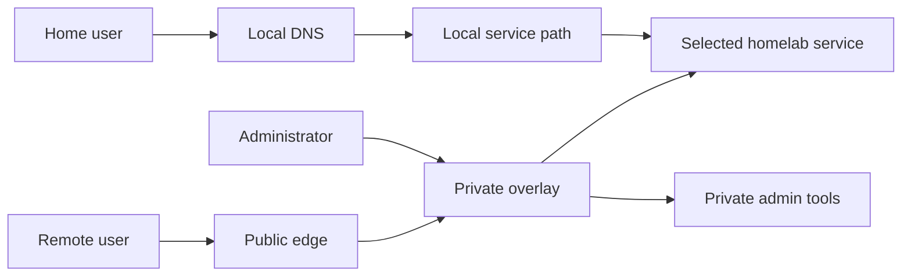

## Request paths

The diagram describes the target pattern, not a deployable configuration. DNS is a naming mechanism, not an authorization control. Administrative services require an explicit access policy at the network or application boundary.

## Design boundaries

- Keep private administration reachable only through approved identities and devices.
- Keep public ingress limited to services with a deliberate public use case.
- Keep the LAN path local when users and services share a home network.
- Keep databases and application state on storage appropriate to their recovery and performance needs.
- Treat redundancy, snapshots, and backups as separate concerns; test restores.

## Failure cases addressed by the design

- If an overlay peer or route is unavailable, keep private administration closed rather than publishing a fallback route.
- If local DNS is unavailable or stale, verify the resolver and record before changing service exposure.
- If the public edge is reachable while a homelab service is down, distinguish edge health from backend health and keep the unavailable service out of rotation.
- If a data disk is absent or unhealthy, verify the expected filesystem mount and stop dependent writes.
- If a backup completes but restore validation fails, treat recovery as unverified; backup-job success alone is not restore evidence.

These are operator principles, not claims that the private environment's failure modes were reproduced by this repository. The local network-boundary and backup/restore exercises use synthetic values and run independently of that environment; they do not expose its actual address plan, firewall rules, or service manifests.

The runnable local demo in `demo/` models only public-versus-private network reachability. Its Docker network is not an identity-aware overlay, and its IP allow-list is not a substitute for device/user authentication.

## Lessons extracted from a private homelab

- A public VPS can be the remote TLS edge while the home network accepts no inbound router ports; an encrypted overlay connects only selected backends.
- A separate LAN edge and split DNS can keep local clients on a local path while preserving the same application hostname and trusted TLS identity. DNS selects a route; it does not authorize a user.
- Bind application listeners to the intended private interface and test that no service accidentally listens on every interface.
- Keep databases and application state on storage selected for their recovery and performance needs. A merger or other storage pool is not a backup and should not hold irreplaceable state by default.
- Validate the expected disk identity and mount before starting services that could interpret an empty mountpoint as empty user data. Stop without deleting when a dependency disappears.
- Encrypted backups need integrity checks and isolated restore drills. State which source data is excluded and what that means for host-loss recovery.
